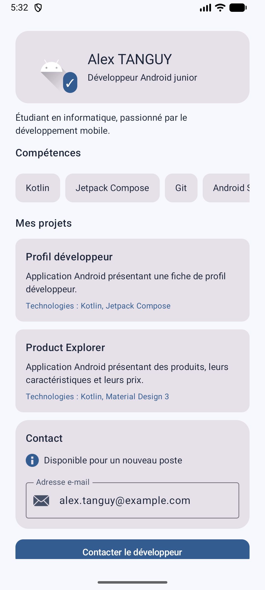
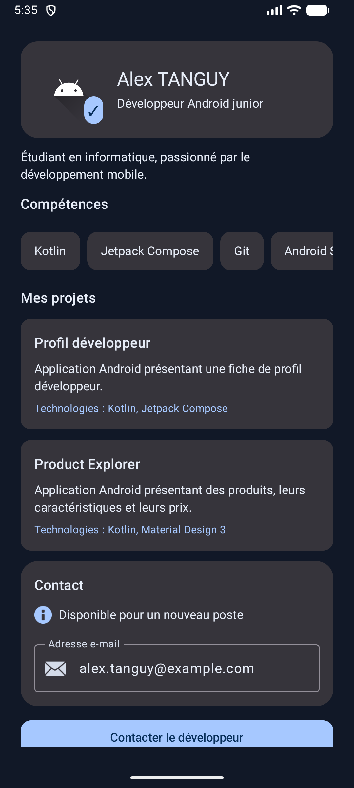

# DeveloperProfile CC2 — Profil développeur avec Jetpack Compose

## Présentation

Application Android réalisée en Kotlin avec Jetpack Compose pour le devoir CC2 « Amélioration UI du Profil développeur ».

Elle présente le profil fictif d'Alex TANGUY, développeur Android junior : rôle, présentation, compétences, projets et coordonnées. Les données sont définies localement dans le code Kotlin ; aucune API ni base de données n'est utilisée.

## Fonctionnalités

- Carte d'en-tête avec avatar et informations de profil.
- Liste horizontale défilante des compétences.
- Liste verticale défilante de projets avec description et technologies.
- Carte de contact avec disponibilité et adresse e-mail en lecture seule.
- Bouton « Contacter le développeur » : callback présent, sans action externe pour ce devoir.
- Affichage en thème clair et en thème sombre.
- Deux previews Compose pour visualiser les rendus.

## Composants Compose utilisés

- `Text` pour les titres et les descriptions.
- `Image` et `Icon` pour l'avatar et les informations visuelles.
- `Card` et `Surface` pour regrouper les informations.
- `OutlinedTextField` en lecture seule pour l'adresse e-mail.
- `Button` pour l'action de contact.
- `@Composable`, paramètres, `Modifier` et callback `onClick` pour construire des composants réutilisables.

Composants réutilisables : `ProfileHeader`, `SkillCard`, `ProjectCard`, `ContactInfo` et `ProfileAction`.

## Layouts et listes

- `Column` : organisation verticale à l'intérieur des cartes.
- `Row` : avatar et texte côte à côte, ou icône et information.
- `Box` : superposition du badge sur l'avatar.
- `Spacer` : espaces entre les éléments.
- `LazyRow` : liste de compétences défilante horizontalement, avec une `SkillCard` pour chaque compétence.
- `LazyColumn` : écran principal défilant verticalement, avec une `ProjectCard` pour chaque projet.

L'utilisation de `LazyColumn` permet d'afficher les différentes sections sur un petit écran sans couper le contenu. `LazyRow` permet d'accéder aux compétences qui dépassent la largeur disponible.

## Thème Material Design 3

L'application utilise `MaterialTheme.colorScheme` pour les couleurs, `MaterialTheme.typography` pour la hiérarchie des textes et `MaterialTheme.shapes` pour les coins arrondis. Deux palettes sont prévues : un fond clair avec des accents bleus et un fond sombre avec des surfaces foncées et des accents bleus plus clairs. Le thème affiché sur l'application suit le réglage du système.

## Captures d'écran

### Mode clair

### Mode sombre

## Previews

Le fichier `MainActivity.kt` contient deux previews :

- `ProfilePreview` : profil Alex TANGUY en mode clair.
- `SecondProfilePreview` : profil Camille Durand en mode sombre.

## Lancement

1. Ouvrir le dossier du projet dans Android Studio.
2. Synchroniser Gradle.
3. Sélectionner un émulateur Android.
4. Exécuter la configuration `app` avec **Run**.

## Quelles notions du chapitre Compose UI ont été réutilisées ?

J'ai réutilisé les composables de base (`Text`, `Image`, `Icon`, `Button`, `Card`, `OutlinedTextField`), les layouts (`Column`, `Row`, `Box`, `Spacer`), les listes `LazyColumn` et `LazyRow`, ainsi que les paramètres, les callbacks et les modifiers. J'ai également utilisé Material Design 3 pour les couleurs, la typographie, les formes et les aperçus clair et sombre.
